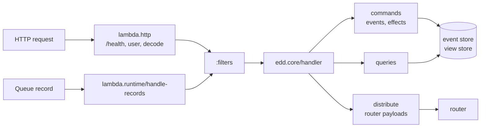
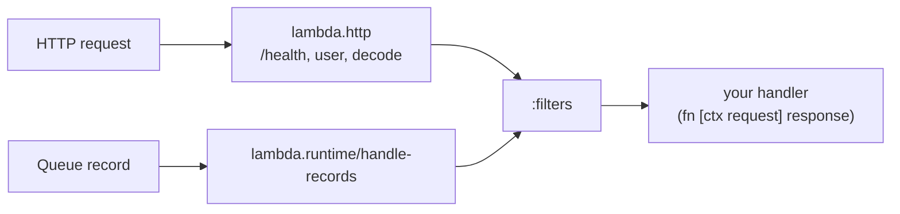

# edd-core

Clojure library for event-sourced CQRS services: commands produce events,
events build aggregates, effects chain commands across services.

<blockquote>
  It is not a framework!
</blockquote>

The library is a set of functions expressing the target architecture. It pushes
state to the edge of the system and helps keep handlers pure, without stopping
you from doing anything else (e.g. using a DB connection directly).

`CLAUDE.md` is the implementation guide (registration API, testing patterns),
`MIGRATIONS.md` lists breaking changes and how to migrate.

## Getting started

Generate a service with the scaffold (`modules/edd-core-scaffold`):

```bash
clojure -Sdeps '{:deps {com.alpha-prosoft/edd-core-scaffold {:mvn/version "2.343.0"}}}' \
  -M -m edd.scaffold my-svc
```

It asks for runtime, distributor, stores and deployment and writes a project
that passes its own tests, with security, authentication and the remote deps
resolver wired in.

The version is the release of the latest commit,
`{project.json version}.{commit count}.0` (`./version.sh`); generated deps
use the same version.

## Modules

| Module | Provides |
|---|---|
| `edd-core` | Registration (`edd.core`), command/query/event pipeline, features, memory stores, Postgres event store, distribution API with the memory transport and the router fan-out, runtime pipeline (`lambda.runtime`, `lambda.http`), test fixtures |
| `edd-core-aws` | Lambda custom runtime, AWS clients, DynamoDB event store, S3 view store, Cognito authentication and credentials, CloudWatch EMF metrics |
| `edd-java-lambda-runtime` | Lambda Java runtime with SnapStart |
| `edd-core-undertow` | Long-running HTTP runtime that also consumes the service queues |
| `edd-core-sqs` / `edd-core-kafka` | Transports for effects and router messages |
| `edd-core-distributor-postgres` | Transport for a single service on the Postgres event store: an outbox, no router |
| `edd-core-flyway` | Runs the migrations the registered components declare, at startup |
| `edd-router` | Router service entry point |
| `edd-core-client` | HTTP client and the HTTP resolver for remote deps |
| `edd-core-security` | Role-based authorization |
| `edd-core-opensearch` | OpenSearch view store |
| `edd-core-view-store-postgres` | Postgres view store with history |
| `edd-core-scaffold` | Project generator |
| `edd-core-io`, `-json`, `-parquet`, `-xlsx`, `-nippy`, `-clj`, `-import`, `-dev` | Utilities |

## Architecture

A service registers commands, events, effects and queries on a ctx map and
runs on a runtime:

```
Command → Handler → Events → Event Store
                  ↓
                  Effects (reg-event-fx) → router → other services' commands
                  ↓
                  Aggregate (reg-event) → View Store
```

- Event stores: Postgres, DynamoDB, memory.
- View stores: Postgres, OpenSearch, S3, memory.

### Effects

Effects are commands created from events. They are stored with the events in
one transaction and executed asynchronously on the target service, so nothing
is triggered for a command that failed or rolled back.

```clojure
; same service
(edd.core/reg-event-fx ctx :user-created
  (fn [ctx event]
    {:cmd-id :send-email
     :id (:id event)}))

; another service
(edd.core/reg-event-fx ctx :user-created
  (fn [ctx event]
    {:service :email-svc
     :commands [{:cmd-id :send-email
                 :id (:id event)}]}))
```

### Runtimes and filters

A runtime runs a handler, `(fn [ctx request] response)`. The service starts
the runtimes it runs on itself, one or several: `edd.undertow.core/start`,
`aws.lambda/lambda-custom-runtime`, `edd.java-lambda-runtime.core/start`.

Each runtime decodes its input the same way: HTTP requests (API Gateway on
Lambda, Undertow) go through `lambda.http`, which answers `/health`,
authenticates the user, distributes router payloads and encodes the
response. Queue records (SQS, Kafka) are handled one request each. Both run
through the `:filters` and then the handler.

#### edd service

`edd.core/handler` dispatches commands and queries to the registrations on
ctx:



```clojure
(edd.undertow.core/start
 ctx
 edd.core/handler
 :filters [aws.filters/from-bucket])
```

#### Own handler

Any other fn runs on the same runtimes, with the same decoding,
authentication and filters, and without the edd pipeline:



```clojure
(defn handler
  [ctx request]
  {:echo request})

(aws.lambda/lambda-custom-runtime ctx handler)
```

It needs no distributor.

#### Filters

`:filters` wrap the handler like servlet filters, first one outermost:

```clojure
(defn audit
  [ctx request chain]
  (let [response (chain ctx request)]
    (log/info "handled" (:request-id request))
    response))

(edd.undertow.core/start ctx edd.core/handler :filters [aws.filters/from-bucket audit])
```

### Distribution

Effects and events reach other services through the router. A service
registers one transport: `edd.sqs.distributor/register`,
`edd.kafka.distributor/register`, or `edd.distribution.memory/register` in
tests (`mock/ctx` already has it). The router registers the same transport and
runs `edd.router.core/handler`. Without a transport every request to
`edd.core/handler` fails with `No distributor registered`.

A single service on the Postgres event store needs neither router nor queues:
`(edd.postgres.distributor/register ctx)` (edd-core-distributor-postgres)
delivers its events and effects to the service itself from an outbox in the
same database. The outbox is a schema of its own per realm,
`<realm>_distributor`.

A service that owns its database migrates it at startup with
`(edd.flyway/register ctx)` (edd-core-flyway): the Postgres event store, view
store and distributor declare their migrations (`edd.ctx/put-migration`) and
the feature runs them for every realm of `:realms` on ctx, `[:prod]` by default.
The marker is written in the transaction of the command, a poller per realm
delivers it and retries with backoff; after `:max-attempts` the marker stays
with `failed_at` set. Undertow only, and an effect for another service fails
the command.

Responses travel to the router inline. A service with big responses registers
a response cache, `(edd.response.s3/register ctx)`: the response is stored in
S3 in parts and the router messages carry only references.

### Remote dependencies

`:deps` with a `:service` are resolved by the registered deps resolver;
startup fails without one. `edd-core-client` provides the HTTP resolver with
pluggable credentials:

```clojure
(edd.client.deps/register ctx {:credentials (aws.cognito/credentials)})
```

Without `:credentials` the token comes from the `ServiceToken` env var.

### Authentication

Authentication is a runtime filter: `(lambda.http/authenticate resolve-user)`
resolves the user of an HTTP request with `(fn [ctx] user)` and passes requests
from other sources on. The runtime resolves nobody itself, it only refuses an
HTTP request that reaches the handler without a user. `aws.cognito/authenticate`
(edd-core-aws, with `(aws.cognito/register ctx)` for its keys) and
`edd.undertow.jwt/authenticate` (edd-core-undertow, any identity provider, see
its README) are such filters. The Cognito one reads the user from the Cognito
JWT in the `X-Authorization` header (used instead of `Authorization`, which API
Gateway and load balancers may take over) or from the API Gateway authorizer.
The role is chosen from the token roles; with several, the request body names
it with `{:user {:selected-role :user-role}}`.

Queue records have no caller, so a filter fills in their user:
`(edd.kafka.filters/authenticate)`, `(edd.sqs.filters/authenticate)`,
`(edd.postgres.distributor.filters/authenticate)`, or
`(lambda.runtime/authenticate-records)` for every queue record. By default
that is the service's `:non-interactive` user, so effects and events run as the
service whoever triggered them; `:resolve-user (fn [ctx request])` picks
another one. Without such a filter a record runs as the user in its `:meta`.

### Authorization

The `edd-core-security` module adds role-based authorization on top of
authentication. Policies are AWS-IAM-style data with Malli conditions,
compiled at startup and evaluated before every command and top-level query:

```
(security/register ctx
  :policies [{:description "am can create orders"
              :principal {:role :account-manager}
              :effect :allow
              :action :create-*}])
```

Alternatively — exclusively, not combined with `:policies` — authorization is
declared inline on each registration and compiled into the same policies at
startup:

```
(edd/reg-cmd ctx :approve-order handler
  :auth {:role [:supervisor :admin]
         :fn (fn [ctx cmd] boolean)})
```

Everything not explicitly allowed is denied — including `:non-interactive`
(service-to-service) traffic, which needs its own allow policy to keep
effects and workflows running. Inline `:auth` is only enforced once
`security/register` is called.
See `modules/edd-core-security/README.md` for the policy format, condition
env, evaluation order and audit-mode rollout.

## JSON Serialization and De-Serialization

Serialization is implemented using `metosin/jsonista` (Crrently using
fork of metosin `alpha-prosoft/jsonista`). Implementation is actually
using jackson. Special metion here is required because there is some
customization done for serializing keyword values and uuid data type.

All keyward **values** are prefixed with ":". If value is already
containing ":" it will duplicate first ":". All uuid values will be
serialized prefixed with "#".

```clojure
=> (:require  [lambda.util :as util])
=> (util/to-json {:a :b})
"{\"a\":\":b\"}"
=> (util/to-json {:a #uuid "d13d8c5c-2704-4fe1-8938-c339db9db15c"})
"{\"a\":\"#d13d8c5c-2704-4fe1-8938-c339db9db15c\"}"
=> (util/to-json {:a "#some"})
"{\"a\":\"##some\"}"
```

```clojure
=> (:require  [lambda.util :as util])
=> (util/to-edn "{\"a\":\":b\"}")
{:a :b}
=> (util/to-edn "{\"a\":\"#d13d8c5c-2704-4fe1-8938-c339db9db15c\"}")
{:a #uuid "d13d8c5c-2704-4fe1-8938-c339db9db15c"}
=> (util/to-edn "{\"a\":\"##some\"}")
{:a "#some"}
```

## UUID Gen
In namespce `lambda/uuid` there is helper function `gen` which can be used
got generating uuid's.

UUID generation is tricky from testing perspective. To help with that there
is implementation of with-state mock is provided. Example of usage:

```clojure
=> (:require [clojure.test :refer :all]
             [lambda.test.fixture.state :as state]
             [lambda.uuid :as uuid])
=> (deftest test-input
    (let [uuid1 (uuid/gen)
          uuid2 (uuid/gen)
          uuid3 (uuid/gen)]
      (state/with-state
        (with-redefs [uuid/gen (fn []
                             (state/pop-item
                              :uuid/gen
                              [uuid3 uuid2 uuid1]))]
          (is (= uuid1
              (uuid/gen)))
          (is (= uuid2
              (uuid/gen)))
          (is (= uuid3
              (uuid/gen)))
          (is (= nil
              (uuid/gen)))))))

```

## Testing

`edd.test.fixture.dal` runs handlers against in-memory stores:

```clojure
(mock/with-mock-dal
  {:event-store [{:event-id :user-created :id user-id}]
   :deps [{:service :remote-svc
           :query {:query-id :get-user}
           :resp {:name "John"}}]}
  (mock/handle-cmd (my/register mock/ctx)
                   {:commands [{:cmd-id :update-user :id user-id}]})
  (mock/verify-state :event-store [...]))
```

`:deps` answer remote dependencies by service, realm and query; `verify-state`
checks `:event-store`, `:aggregate-store`, `:command-store`, `:identity-store`.

`edd.test.fixture.runtime` runs the whole request path (authentication, filters,
`edd.core/handler`, distribution) on the in-memory runtime `lambda.runtime.memory`,
as an API request of a given user or as a batch of queue records:

```clojure
(require '[edd.test.fixture.runtime :as runtime])

(mock/with-mock-dal
  (let [svc (runtime/start (my/register mock/ctx)
                           :user {:id "am@example.com" :role :account-manager
                                  :roles [:account-manager] :realm :test})]
    (runtime/post svc {:request-id (uuid/gen) :interaction-id (uuid/gen)
                       :commands [{:cmd-id :update-user :id user-id}]})
    ;; => {:status 200 :body {:result {...}}}
    (runtime/handle-records svc [{:apply {:aggregate-id user-id} ...}])
    ;; => {:responses [...] :redeliver? false}
    (runtime/routed)))                       ;; records sent to the router
```

| Command | Runs |
|---|---|
| `make test-unit` | Unit tests |
| `make it` | Pre-build setup (Docker, migrations) and integration tests |
| `make e2e-local` | ping/pong/router on Undertow + Kafka + Postgres and mono-svc on the Postgres distributor, in docker compose |

CI also deploys the same services on Lambda + SQS + DynamoDB + S3 and runs the
same `e2e/it` suite against both.

# Database Semantics

## Table Semantics
### command_request_log
This table will contain all command requests, including those incoming from the client (e.g. FE), and also those resulting from effect commands.
For a documentation of the breadcrumbs column please see the section about breadcrumbs below.
Events created for a command will have the same [request_id,breadcrumbs] combination in the _event_store_ table as the corresponding _command_request_log_ entry, except events created by incoming commands will have a breadcrumbs value of "0" in the events table, instead of the blank value in _command_request_log_.
CAVEAT: Single requests can result in multiple entries in this table if there are retries for a request, e.g. if a browser will repeat a request after network issues. Also AWS does not guarantee that a lambda will be triggered exactly once per request. In the future there will be a _retry_ column in this table to state if a given request resulted from a retry to allow filtering for this.
command_request_log is written before transactions start. If a transaction needs to be rolled back, then all the other tables will not be written. To find out which requests in _command_request_log_ were not processed successfully they can be identified by request_ids for which there are no corresponding entries in _command_response_log_.
Fields to be added:
- retry_count: integer; increments with each retry
- error_message: if a request failed, error message will be put there
- success: boolean; true if request was processed successfully

### command_response_log
Contains the response sent to the client (e.g. FE).
Only if a command was processed successfully, an entry will be written here containing the response sent by the backend to the client (FE), compare documentation about _command_request_log_.
There is a field _success_ contained in the _data_ column json document, but it will always be true, because requests that fail will not be written to _command_response_log_.
The _command_response_log_ is used for de-duplication. If a request is identified with a [request_id,breadcrumbs] combination that already exists in this table, then the request will not be processed again but the response will be taken from _command_response_log_. Technically, the request's transaction will fail because of the unique [request_id,breadcrumbs] constraint is violated. The system can recover from this situation by checking the _command_response_log_ whether the request was already processed successfully, and if so return the success message to the client.

### command_store
Contains only the commands created in course of effects, not the original commands as issued by the client (e.g. FE).
It also lists the _source_service_ and _target_service_ for a command.
Can be used to identify effect communication edges between service nodes. Breadcrumbs will be in sync with breadcrumbs in the _command_request_log_.
Breadcrumbs can be used to trace back from _commands_store_ to the original requests in _command_request_log_.

### event_store
Whenever an event handler was processed successfully, an entry will be written to _event_store_, also containing the contents of the event itself.
There is a unique constraint on the tuple [service_name,aggregate_id,event_seq] to support optimistic locking, so concurrent requests will not accidentally modify one and the same entity.

## Scoped IDs
### invocation_id
_invocation_id_ identifies the invocation that handled the request: the Lambda request id (header lambda-runtime-aws-request-id), or a generated uuid on Undertow. It is mainly used to search the logs, to map command execution to log entries.
### request_id
The _request_id_ is generated by the client (e.g. FE), when a new request to the backend is done. It has to be unique on a per request base, and the client is responsible for keeping this contract.
CAVEAT: If the request-id is re-used, edd-core returns the stored response of the first request and distributes its stored events and effects again.
In the context of one request, multiple commands and corresponding events can be generated.
One and the same request-id is re-used for all effects triggered by a service call.

### interaction_id
Semantically this mostly is a session-id. On opening a user session in the client (e.g. FE browser), one interaction-id is created and used during the whole session. _interaction_id_s come in handy when debugging tests (to tell one test's outcomes from another's).

## Breadcrumbs
Generally, breadcrumbs trace inter-service-calls caused by effects. Using breadcrumbs it is possible to trace the sequence of downstream service calls triggered by effects.
Sample values:
- '' or '0' for original requests. _command_request_log_ will have blanks, the other tables will have '0's.
- '0:0' first effect command triggered on original svc
- '0:1' second effect command triggered on original svc
- '0:1:0' first effect command on transitive svc
- ...

# Logging

## Local logging setup

For local logger user follwing alias:
```
 :local {:jvm-opts ["-Dclojure.tools.logging.factory=lambda.logging-local/slf4j-local-factory"]}}
```

Example output
```
INFO Storing mock request {:commands [{:type :application, :id #uuid "3cd53114-1a56-427f-99a1-a5512c8e15c1", :cmd-id :folder->initialize}]}
INFO Emulating get-command-response-log nil [0]
  INFO START handle-request; memory(mb): 193
  INFO Requst meta:  {:user {:id john.smith@rbinternational.com, :email john.smith@rbinternational.com, :role :lime-account-managers}}
    INFO START handling-command: :folder->initialize; memory(mb): 193
      INFO START Fetching all deps for :folder->initialize; memory(mb): 193
      INFO Query for dependency :folder locally
        INFO START handling-query: :get-by-id; memory(mb): 193
        INFO Fetching snapshot aggregate:  #uuid "3cd53114-1a56-427f-99a1-a5512c8e15c1"
        INFO Snapshot not found
        INFO Emulated 'get-events' dal function
        INFO Events to apply: 0
        INFO END handling-query: :get-by-id; elapsed(msec): 0.206019; memory(mb): 193 -> 193
      INFO END Fetching all deps for :folder->initialize; elapsed(msec): 0.475349; memory(mb): 193 -> 193
    INFO Fetching snapshot aggregate:  #uuid "3cd53114-1a56-427f-99a1-a5512c8e15c1"
    INFO Snapshot not found
    INFO Emulated 'get-events' dal function
    INFO Events to apply: 0
    INFO END handling-command: :folder->initialize; elapsed(msec): 1.607723; memory(mb): 193 -> 193
  INFO END handle-request; elapsed(msec): 2.174456; memory(mb): 193 -> 193
  INFO START assign-breadcumbts; memory(mb): 193
  INFO END assign-breadcumbts; elapsed(msec): 0.049571; memory(mb): 193 -> 193
  INFO START summarize-response; memory(mb): 193
  INFO END summarize-response; elapsed(msec): 0.050909; memory(mb): 193 -> 193
```

## Disable printing metrics

Metrics are logged every 10 seconds; set `DisableMetrics` (any value) to stop
them, e.g. in a local REPL:

```bash
DisableMetrics=true clojure -M:dev
```
